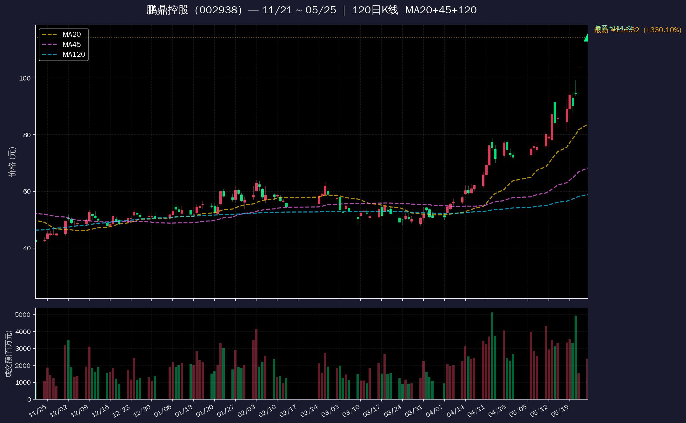

# 全球市场速查

## 目录结构

```
global-market/
├── SKILL.md                # 本技能定义文档
├── scripts/
│   ├── run.py              # 主查询脚本（个股/基金/外汇/指数/板块/K线图）
│   └── build-fund-mapping.py  # 板块→基金映射构建脚本（生成 etf-mapping.md + fund-nav-history.csv）
├── charts/                 # 运行时生成的K线图（自动创建）
│   └── *.png               # 按参数动态命名，如 002938_K120_MA20_MA45_MA120.png
├── assets/                 # 静态资源
│   └── stock-chart-preview.png  # 个股K线效果预览图
└── references/
    ├── charting.md              # matplotlib K线图生成参考（含数据源详解）
    ├── csi-indices.md           # CSI 中证指数（H-series）数据源
    ├── datasource-reference.md  # 各数据源字段详解
    ├── environment.md           # 腾讯云环境适配说明
    ├── etf-mapping.md           # 板块→主题基金映射表（37板块48基金，含最新净值+多周期涨跌幅）
    ├── fund-api.md              # 天天基金净值 API
    ├── fund-nav-history.csv     # 全部基金历史净值数据（51764+条），用于统计分析和回测
    ├── ifzq-api.md              # Tencent ifzq API（A股/港股历史K线）
    ├── lof-mapping.md           # 用户提供的板块→LOF/联接基金原始映射
    ├── nasdaq-api.md            # 新浪美股 API（指数历史 + 个股历史）
    ├── sector-mapping.md        # A股板块名称映射表
    └── us-futures-sources.md    # 美股期货数据源排查记录
```

## When to Use
- 用户查询任何股票、基金（代码）、货币的行情
- 用户说"查一下 XXX"、"XXX 行情"、"XXX 最新价"、"看看 XX"
- 用户说"全球市场"查看概览
- 用户输入股票代码（A股6位、美股字母、港股5位）、基金代码（6位，如016814）或外汇关键词
- 用户查询批量**板块/行业/概念**涨跌幅（如"帮我查下CPO、机器人、有色金属这几个板块"）

## Procedure

1. 接收用户查询关键词（股票名称、代码、基金代码、外汇关键词，或逗号分隔批量查询）
2. 执行脚本自动识别市场类型并返回行情：

   ```bash
   ~/venv/bin/python3 ~/.hermes/skills/fsi/global-market/scripts/run.py "<查询内容>"
   ```

3. 直接打印脚本标准输出 — 已格式化含 emoji 表情符号，无需额外处理
4. 如果脚本返回 `❌` 开头，说明查询失败

**批量查询**：逗号分隔多个查询，如：

   ```bash
   ~/venv/bin/python3 ~/.hermes/skills/fsi/global-market/scripts/run.py "茅台,AAPL,00700"
   ```

**指数历史分析**：查询美股指数近一个月走势（通过新浪美股 API）：

   ```bash
   ~/venv/bin/python3 ~/.hermes/skills/fsi/global-market/scripts/run.py --history NDX
   ~/venv/bin/python3 ~/.hermes/skills/fsi/global-market/scripts/run.py --history SPX
   ~/venv/bin/python3 ~/.hermes/skills/fsi/global-market/scripts/run.py --history DJI
   ~/venv/bin/python3 ~/.hermes/skills/fsi/global-market/scripts/run.py --history COMP
   ```

   支持全部4个主要美股指数：NDX（NASDAQ-100）、SPX（S&P 500）、DJI（道琼斯）、COMP（NASDAQ Composite）。

**生成K线走势图**：在指数历史分析基础上增加 matplotlib 暗色主题K线图（含5日/20日均线、成交量柱）：

   ```bash
   ~/venv/bin/python3 ~/.hermes/skills/fsi/global-market/scripts/run.py --history SPX --chart
   ~/venv/bin/python3 ~/.hermes/skills/fsi/global-market/scripts/run.py --history NDX --chart
   ```

   输出：文字分析 + 图片存入 `charts/` 文件夹，如 `NDX_history.png`（~132KB, 150dpi）。

**个股K线趋势图**：查询 A 股/美股/港股行情并生成K线趋势图，K线天数和均线列表均可自定义：

   使用 `--chart` 标志启动绘图，配合 **动态参数格式** `<股票>,K<天数>,[MA<周期1>,MA<周期2>,...]` 灵活控制图表参数：

   ```bash
   # 默认：90日K线 + MA20/MA90
   ~/venv/bin/python3 run.py 600519 --chart
   ~/venv/bin/python3 run.py AAPL --chart

   # 自定义K线天数 + 均线列表（逗号分隔，无需 --chart）
   ~/venv/bin/python3 run.py "002938,K120,[MA20,MA45,MA120]"
   ~/venv/bin/python3 run.py "茅台,K60,[MA10,MA20]"
   ~/venv/bin/python3 run.py "AAPL,[MA50,MA100,MA200]"
   ~/venv/bin/python3 run.py "00700,K200"
   ```

   - `--chart` 不传动态参数时使用默认值（90日 + MA20/MA90）
   - 传入动态参数时自动取代默认值（`--chart` 可省略）
   - K线天数不足指定值时按实际可用天数展示
   - 均线周期大于数据长度时自动跳过该均线
   - K线颜色：A股/港股 **红涨绿跌**（亚洲惯例），美股 **绿涨红跌**（欧美惯例）
   - 成交量柱：A股自动换算为 **成交额(百万元)**（手数 × 收盘价 / 10000），美股保持 Volume

   输出：行情文字 + 图片存入 `charts/` 文件夹，按参数动态命名，如 `002938_K120_MA20_MA45_MA120.png`（~180KB, 150dpi）。
   数据源：A股/港股走 **Tencent ifzq** API（前复权），美股走新浪 **US_MinKService** API。

   **效果预览：**

   

 **板块查询**：查询 A 股概念/行业板块涨跌幅

   ```bash
   # 查询特定概念板块（逗号分隔）
   ~/venv/bin/python3 ~/.hermes/skills/fsi/global-market/scripts/run.py --sector "CPO,机器人,存储芯片"

   # 模糊匹配
   ~/venv/bin/python3 ~/.hermes/skills/fsi/global-market/scripts/run.py --sector 半导体

   # 所有概念板块排行（按涨跌幅降序）
   ~/venv/bin/python3 ~/.hermes/skills/fsi/global-market/scripts/run.py --sector all

   # 所有行业板块排行
   ~/venv/bin/python3 ~/.hermes/skills/fsi/global-market/scripts/run.py --sector all --industry

   # 板块速览（涨跌前 5）
   ~/venv/bin/python3 ~/.hermes/skills/fsi/global-market/scripts/run.py --sector all --top5
   ```

**基金代码兜底**（v1.1.0 自动处理）：6 位纯数字输入 → 先查 A 股 → 若 A 股无此代码 → 自动尝试天天基金净值 API。无需手动区分基金代码。

**CSI 中证指数兜底**：如果查询代码以 H 开头（如 H30269），且脚本返回 ❌，则走 CSI 指数兜底流程（参见下方【CSI 中证指数查询】章节）。

### 数据流示意

```
用户输入 "016814"
  → detect_market() → market="a", identifier="016814"
  → query_a_stock("016814") → sh/sz 都返回无匹配
  → 自动调用 query_fund("016814") → 天天基金 API ✅
  → 返回格式化基金行情

用户输入 "茅台,AAPL,00700"
  → detect_market() 对每个输入判断
  → batch_query() 并行（实际串行）查询各市场
  → 分割线分隔结果
```

## 市场自动识别

脚本 `scripts/run.py` 中的 `detect_market()` 按以下优先级判断市场类型：

| 优先级 | 市场 | 匹配规则 | 示例 |
|--------|------|----------|------|
| 1 (最高) | 外汇 (fx) | 含「汇率」「美元」「欧元」「USD」「CNY」等关键词 | "汇率美元", "USD/CNY", "美元兑欧元" |
| 2 | 港股 (hk) | 5位纯数字 或 `.HK` 后缀 | "00700", "00700.HK" |
| 3 | 美股/指数 (us) | 1-5位纯英文字母（排除 SH/SZ/HSI） | "AAPL", "NDX", "SPX", "DJI" |
| 4 | CSI 中证指数 (csi) | 6位以上字母数字混合，以字母开头（如 H30269）| "H30269", "H00973" |
| 5 (兜底) | A股 (a) | 中文名称、6位纯数字代码或任何其他输入 | "茅台", "600519" |

**注意**：美股指数（NDX、SPX、DJI）走腾讯行情快照，显示当前价和涨跌幅。如需深度历史分析（周涨跌幅、最大回撤），使用 `--history NDX` 模式。A股名称搜索通过新浪建议接口（suggest3.sinajs.cn）转换为代码后再查行情。

**CSI 中证指数（H-series）**：此类指数代码以 H 开头（如 H30269 中证红利低波），不在腾讯 qt.gtimg.cn 或新浪 hq.sinajs.cn 的覆盖范围内。参见下方【CSI 中证指数查询】章节获取兜底方案。

### 指数代码支持详情

| 代码 | 指数名称 | 快照查询 | 历史分析 (`--history`) | K线图 (`--chart`) |
|------|----------|----------|----------------------|-------------------|
| NDX | NASDAQ-100 | ✅ 腾讯行情 usNDX | ✅ 新浪美股 API | ✅ matplotlib |
| SPX | S&P 500 | ✅ 腾讯映射 usINX | ✅ 新浪美股 API (.INX) | ✅ matplotlib |
| DJI | Dow Jones | ✅ 腾讯映射 us.DJI | ✅ 新浪美股 API (.DJI) | ✅ matplotlib |
| COMP | NASDAQ Composite | ❌（与 Compass 股票冲突） | ✅ 新浪美股 API (.IXIC) | ✅ matplotlib |

## 天天基金净值 API (fundgz.1234567.com.cn) 字段

> 脚本 v1.1.0+ 已内置此兜底逻辑，6位数字输入自动尝试。以下为参考字段说明。

格式：`jsonpgz({"fundcode":"...","name":"...","jzrq":"...","dwjz":"...","gsz":"...","gszzl":"...","gztime":"..."})`

**注意**：`gsz` / `gszzl` 是盘中估算值，不是官方净值。官方净值（`dwjz`）在交易日收盘后公布。

## 数据源

| 市场 | 数据源 | 接口 | 依赖 |
|------|--------|------|------|
| **A股** | 腾讯行情 | `qt.gtimg.cn/q=sh{code}` / `q=sz{code}` | requests (无需 akshare) |
| **基金** | 天天基金 | `fundgz.1234567.com.cn/js/{code}.js` | requests（脚本内置兜底） |
| **美股** | 腾讯行情 | `qt.gtimg.cn/q=us{symbol}` | requests (无需 yfinance) |
| **港股** | 新浪行情 | `hq.sinajs.cn/list=hk{code}` (需 Referer header) | requests |
| **A股历史K线** | Tencent ifzq | `web.ifzq.gtimg.cn/appstock/app/fqkline/get?param=sh{code},day,,,{days},qfq` | requests (返回 qfqday 前复权) |
| **港股历史K线** | Tencent ifzq | `web.ifzq.gtimg.cn/appstock/app/fqkline/get?param=hk{code},day,,,{days},qfq` | requests (返回 day) |
| **外汇** | open.er-api.com | `GET /v6/latest/{base}` | requests |
| **A股名称→代码** | 新浪建议 | `suggest3.sinajs.cn/suggest/?key={name}&type=11,12` | requests |
| **CSI H-series** | 天天基金 | `fundgz.1234567.com.cn/js/{code}.js`（通过跟踪基金推算） | requests |
| **证券名称→代码** | Tencent smartbox | `smartbox.gtimg.cn/s3/?v=2&q={name}&t=all`（返回 GBK 编码） | curl + iconv |
| **指数历史** | 新浪美股 | `stock.finance.sina.com.cn/usstock/api/...`（需 Referer） | requests |

**只依赖 `requests` 一个 pip 包。** akshare 和 yfinance 在部分云环境（特别是腾讯云）可能被拦截/限流。

## 腾讯行情 (qt.gtimg.cn) 字段索引

数据返回格式：`v_{code}="field1~field2~...~fieldN"`，按 `~` 分割。

### A股 (sh/sz 前缀)

| 索引 | 字段 | 示例 |
|------|------|------|
| 1 | 名称 | 贵州茅台 |
| 2 | 代码 | 600519 |
| 3 | 当前价 | 1323.00 |
| 4 | 昨收 | 1332.95 |
| 5 | 今开 | 1336.00 |
| 6 | 成交量(手) | 49661 |
| 31 | 涨跌额 | -9.95 |
| 32 | 涨跌幅% | -0.75 |
| 33 | 最高 | 1342.68 |
| 34 | 最低 | 1319.61 |
| 35 | 组合字段(价/手数/金额) | 1323.00/49661/6594983723 |

### 美股 (us 前缀)

| 索引 | 字段 | 示例 |
|------|------|------|
| 1 | 中文名 | 苹果 |
| 2 | 代码 | AAPL.OQ |
| 3 | 当前价 | 300.23 |
| 4 | 昨收 | 298.21 |
| 5 | 今开 | 297.90 |
| 30 | 时间戳 | 2026-05-15 16:00:02 |
| 31 | 涨跌额 | 2.02 |
| 32 | 涨跌幅% | 0.68 |
| 33 | 最高 | 303.20 |
| 34 | 最低 | 296.52 |
| 35 | 货币 | USD |
| 39 | PE(TTM) | 36.35 |
| 46 | 英文名 | Apple Inc. |
| 48 | 52周最高 | 303.20 |
| 49 | 52周最低 | 192.71 |

A股和美股关键区别：**A股涨跌幅/最高/最低在索引 31-34，美股在索引 31-34 相同**，但 PE 和 52周范围位置不同。

## 新浪港股 (hq.sinajs.cn) 字段索引

格式：`var hq_str_hk{code}="EN_NAME,CN_NAME,PRICE,PREV_CLOSE,HIGH,LOW,OPEN,CHANGE,CHG_PCT,..."`

| 逗号索引 | 字段 | 示例 |
|----------|------|------|
| 0 | 英文名 | TENCENT |
| 1 | 中文名 | 腾讯控股 |
| 2 | 当前价 | 449.400 |
| 3 | 昨收 | 456.400 |
| 4 | 最高 | 457.800 |
| 5 | 最低 | 445.800 |
| 6 | 开盘 | 449.400 |
| 7 | 涨跌额 | -7.000 |
| 8 | 涨跌幅% | -1.534 |
| 11 | 成交额 | 12499006721 |
| 12 | 成交量 | 27772376 |

**注意**：新浪港股 API 需要 `Referer: https://finance.sina.com.cn` HTTP header，否则返回空。

## 外汇格式支持

支持以下查询格式：

- `汇率美元` → USD→CNY
- `美元兑欧元` → USD→EUR
- `USD/CNY` → USD→CNY
- `USD to JPY` → USD→JPY

如果 base 和 target 相同（如"汇率美元"只匹配到 target=USD 但 base 也是 USD），自动 fallback target 为 CNY。

## US 夜盘/盘前/盘后数据局限

### 用户查询场景

用户说「看下美股夜盘」「XXX 盘前涨跌幅」「美股期货现在什么价」「NQ 期货」「纳斯达克100夜盘」等。

### What IS available

- **US 指数快照**（常规交易时段数据）：`~/venv/bin/python3 run.py "NDX"` → 通过腾讯 qt.gtimg.cn/q=usNDX 获取
- **US 指数历史**：`~/venv/bin/python3 run.py --history NDX` → 通过新浪美股 API（日 K 线，含上一个收盘日）
- **US 个股**：`~/venv/bin/python3 run.py "AAPL"` → 通过腾讯 qt.gtimg.cn

### What is NOT available (proven dead ends)

| 数据源 | 目标 | 结果 | 原因 |
|--------|------|------|------|
| **yfinance** `NQ=F`, `NQ00Y.SG` | NQ 期货实时价 | ❌ 429 Rate Limited | Yahoo Finance 限流 |
| **新浪期货** `nf_NQ00Y`, `US_FutKService` | NQ 期货 | ❌ 空数据 / Service not valid | 新浪期货API仅支持国内期货 |
| **新浪美股 K 线** `US_MinKService` | NDX 期货 K 线 | ❌ 返回2014年数据 | 已废弃 |
| **EastMoney push2** `86.NQ`, `86.NQ00Y`, `111.NQ` | 海外期货 | ❌ rc:100 (no data) | 不支持海外期货品种 |
| **腾讯 qt.gtimg.cn** `usNQ`, `usMNQ` | NQ 期货 | ❌ v_pv_none_match | 不覆盖CME期货 |
| **腾讯 qt.gtimg.cn** `usNDX` | NDX 指数盘前价 | ❌ 只返回常规交易时段快照 | 非盘前数据 |
| **Google Finance** `NQ=COMEX` | NQ 期货 | ❌ 超时 / 头渲染不出 | 网络限制+无头Chrome需--no-sandbox |
| **Investing.com / MarketWatch** | NQ 期货 | ❌ Chrome 无法启动 | 需 --no-sandbox |

### What to do when user asks

```bash
# 1. 先提供指数最近收盘数据（这是目前最可靠的信息）
~/venv/bin/python3 ~/.hermes/skills/fsi/global-market/scripts/run.py "NDX"

# 2. 如果用户需要盘中实时（北京时间21:30-次日04:00），直接用上面方法
#    这段时间是美股常规交易时段，腾讯数据是准的。

# 3. 如果是非交易时段（盘前16:00-21:30/盘后04:00-08:00 北京时间）：
#    - 坦诚告知当前环境不支持美股期货/NQ期货实时数据
#    - 提供指数最近收盘数据作为参考（见步骤1）
#    - 建议用户通过 TradingView、富途、老虎等专业平台查看
```

### 时间对应关系

| 美股时段 | 美东时间 (ET) | 北京时间 (UTC+8) |
|----------|--------------|-----------------|
| 盘前 (Pre-market) | 04:00-09:30 | 16:00-21:30 |
| 常规交易 (Regular) | 09:30-16:00 | 21:30-次日04:00 |
| 盘后 (After-hours) | 16:00-20:00 | 04:00-08:00 |
| CME Globex NQ 期货 | ~23h/天 (周日晚-周五下午) | 连续交易 |

### 记忆复用

当用户第一次问夜盘数据并被告知局限后，将用户偏好存入记忆（如「用户知道美股夜盘数据限制，下次直接给NDX指数收盘快照即可」），避免重复解释。

## Common Pitfalls

1. **akshare/yfinance 在腾讯云环境不可用**：Tencent Cloud 拦截 EastMoney API，Yahoo Finance 返回 429。脚本已内置替代数据源（qt.gtimg.cn + hq.sinajs.cn），直接使用 `requests` 无需安装 akshare/yfinance。
2. **新浪港股需要 Referer header**：不加返回空数据。必须在请求头设置 `Referer: https://finance.sina.com.cn`。
3. **新浪港股成交额在索引 11 (raw value)，不是索引 12**：容易混淆，成交量在 12。
4. **美股 52周范围数据来自腾讯字段 48/49（不是 43/44）**：腾讯原始数据中 43/44 是股指参考值，不是个股的 52周范围。
5. **A股名称搜索依赖新浪建议 API，且 market_flag 字段对部分深交所股票返回 11（上海）**：如 002938（鹏鼎控股）返回 `flag=11, market_code=sz002938`。脚本 `search_a_by_name()` 和 `_resolve_a_code()` 已修复——优先从 `market_code` 字段（第4个逗号字段，如 `sz002938`）提取 `sh/sz` 前缀。修复前名称搜索会失败，必须用 6 位代码查询。
6. **港股代码需要 5 位带前导零**：00700 而非 700，脚本自动 `zfill(5)` 处理。
7. **外汇 API 免费但有调用次数限制**：open.er-api.com 无认证免费使用，但频繁调用可能限流。
8. **超出交易时间的行情数据**：返回的是最近收盘价，用户可能误以为是实时价。
9. **基金代码（6位以0/01开头）会被误判为 A 股代码**：脚本默认把 6 位数字路由到 A 股，而基金 6 位代码（如 016814）在腾讯行情查不到，返回 ❌。v1.1.0 已内置自动基金兜底，不再需要手动指定。
10. **指数全名（如"NASDAQ-100"）不被识别**：只能识别短代码（NDX）、6位数字或中文名称。用户输入"NASDAQ-100"会落入 A 股兜底失败。如果用户输入指数全名，提示使用标准代码（NDX、SPX、DJI 等）。
11. **美股夜盘（盘后）数据不可用**：腾讯行情 qt.gtimg.cn 只返回常规交易时段数据。盘后/夜盘价格不在字段中。如需盘后数据，应让用户等到常规交易收盘后（北京时间凌晨4点后）再查询。
12. **6位数字输入自动走基金兜底**：如 016814 先查 sh/sz 都失败后自动查天天基金，无需用户手动指定"基金"关键词。
13. **指数代码（NDX/SPX/DJI）走腾讯行情快照而非历史分析**：直接输入 NDX 返回的是腾讯行情快照（当前价），历史分析需用 `--history NDX` 模式。目前全部4个指数（NDX/SPX/DJI/COMP）均支持历史分析。
14. **批量查询一次最多 5-6 个**：每个查询串行执行，太多会导致总超时。超过 6 个建议分批查。
15. **COMP 不是纳斯达克综合指数**：直接输入 COMP 会查腾讯行情，但返回的是 Compass 股票而非纳斯达克综合指数。查合成指数需用 `--history COMP`。
16. **--chart 依赖 matplotlib + numpy**：这两个包已安装在 `~/venv/` 中。如果将来重装环境，需 `~/venv/bin/pip install matplotlib numpy`。
17. **CSI 中证指数（H-series）不在腾讯/新浪/东方财富标准 API 中**：代码如 H30269 在所有常用接口均不可直接查询，必须走跟踪基金兜底方案。参见【CSI 中证指数查询】章节。
18. **腾讯 smartbox 返回 GBK 编码**：`smartbox.gtimg.cn/s3/` 返回 GBK 编码的文本。需用 `iconv -f GBK -t UTF-8` 转码。参数 `t=all` 返回所有类型（股票/ETF/基金/指数），`t=zs` 只返回指数。
19. **smartbox 搜索用中文名而非代码**：smartbox 使用中文关键词搜索（如"红利低波"），不直接支持 CSI 代码查询。结果格式为 `市场~代码~名称~拼音缩写~类型` 的串联，可用 `^` 分割解析。
20. **CSI 指数涨跌幅为推算值，非精确值**：通过基金 `gszzl` 字段推算的指数涨跌幅可能存在 ±0.05% 的误差。ETF 实时价（如 512890）是市场交易价，也不等于指数精确值。
21. **`--chart` 个股K线图的 A 股数据走 Tencent ifzq 而非 akshare**：`web.ifzq.gtimg.cn/appstock/app/fqkline/get` 返回前复权日线（qfqday 字段），格式 `[date, open, close, high, low, volume]`，volume 单位为手。美股走新浪 `US_MinKService.getDailyK`（1984年起），港股走 ifzq 的 `day` 字段（无前复权）。所有三个市场都需要 `Referer` 或特定参数（已内置）。
22. **个股 `--chart` 依赖 matplotlib + numpy 且需要中文字体**：WenQuanYi Zen Hei 位于 `/usr/share/fonts/truetype/wqy/wqy-zenhei.ttc`。需 `fm.fontManager.addfont()` + `plt.rcParams["font.family"]` 注册。缺少时中文显示为方块。
25. **LOF基金代码不能直接生成K线图**：6位基金代码（如013275）通过天天基金API可查净值，但Tencent ifzq API没有对应K线数据。使用动态参数格式 `"013275,K120,[MA30,MA90,MA120]"` 时，脚本先查出基金行情文字（✅），然后尝试拉K线失败（❌ 0条数据）。正确做法：先查基金→找对应场内ETF（如 013275→515220 煤炭ETF）→用ETF代码重试。
27. **概念名称→基金映射需手动跨表**：akshare 返回的概念名长（如"共封装光学(CPO)"、"机器人概念"），而 lof-mapping.md 使用短名（"CPO"、"机器人"）。收盘日报代码中的 `FUND_MAP` 字典已包含完整跨映射（~50条），新增板块时需同时维护两个名称的映射关系。参见 SKILL.md 【收盘日报推送格式】章节的 `FUND_MAP` 代码块。
28. **`ak.fund_open_fund_info_em()` 可在腾讯云工作**：这是少数在 Tencent Cloud 仍可用的 EastMoney 后端 API。用于批量获取基金历史净值数据。单次约 1-2 秒，连续调用需加 `time.sleep(0.5)` 避免限流。

## Verification Checklist

- [ ] 输入 A 股名称（如"茅台"、"中国平安"）返回正确行情
- [ ] 输入 A 股代码（如"600519"）返回正确行情
- [ ] 输入美股代码（如"AAPL"、"GOOGL"）返回行情 + PE + 52周范围
- [ ] 输入港股代码（如"00700"、"00388"）返回行情 + 成交额
- [ ] 输入外汇关键词（如"汇率美元"、"USD/CNY"、"美元兑欧元"）返回汇率
- [ ] 输入基金代码（如"016814"）自动兜底返回净值 + 估算涨跌幅
- [ ] 批量查询（如"茅台,AAPL,00700"）用分割线分隔各结果
- [ ] 指数历史（`--history NDX`）返回周涨跌幅 + 最大回撤 + 区间振幅
- [ ] K线图（`--history SPX --chart`）生成 matplotlib 图片
- [ ] CSI 中证指数（如 H30269）走跟踪基金兜底，返回指数估算涨跌幅
- [ ] `--sector "CPO,机器人"` 返回概念板块涨跌幅
- [ ] `--sector all` 列出所有概念板块
- [ ] `--sector all --industry` 列出所有行业板块
- [ ] `--sector all --top5` 显示涨跌前5名
- [ ] `--sector 半导体` 模糊匹配到 "第三代半导体"
- [ ] 输入未知代码（如"XXXX"）返回友好错误提示
- [ ] 用户问美股夜盘/盘前/期货数据 → 先给NDX收盘快照，再坦诚说明数据局限
- [ ] 用户问NQ期货 → 告知当前环境无CME期货数据源，不可在非交易时段获取精确盘前价
- [ ] `--chart` A 股/美股/港股各测一次，确认K线图正确生成（含MA20/MA90、成交量、最高/最低标注）
- [ ] `--chart` 配合 A 股名称搜索（如"鹏鼎控股 --chart"）正常走通
- [ ] `--chart` 不会影响已有的 `--history --chart`（两套图表逻辑独立）
- [ ] 中文字体渲染正常，无 matplotlib CJK missing glyph 警告
- [ ] 动态参数格式 `"002938,K120,[MA20,MA45,MA120]"` 正确解析并生成对应K线图
- [ ] 动态参数缺省测试：`"002938,K120"`（无MA）、`"002938,[MA10,MA30]"`（无K天数）
- [ ] 输出文件按参数动态命名，如 `002938_K120_MA20_MA45_MA120.png`
- [ ] 输出路径为 skill 目录下的 `charts/` 文件夹，非 /tmp
- [ ] `--chart` 时 K 线颜色正确：A 股红涨绿跌 <-> 美股绿涨红跌（互为反转）
- [ ] `--chart` 时 A 股成交量柱标签显示"成交额(百万元)"，美股显示"Volume"

## 美股指数历史行情分析 (--history)

当用户需要美股指数的**周涨幅、回撤、历史走势**时，使用 `--history` 模式调用新浪美股 API。

**支持指数**：NDX（NASDAQ-100）、SPX（S&P 500）、DJI（道琼斯）、COMP（NASDAQ Composite）。
**数据源**：新浪美股 `stock.finance.sina.com.cn/usstock/api/jsonp.php`（需 Referer header）。
**数据范围**：2004 年至今，脚本自动截取最近约 30 个交易日。

### 数据获取

```python
import requests
from datetime import datetime, timedelta

url = 'https://stock.finance.sina.com.cn/usstock/api/jsonp.php/var%20data=/US_MinKService.getDailyK?symbol=.INX&datalen=60'
headers = {'Referer': 'https://finance.sina.com.cn'}
r = requests.get(url, headers=headers, timeout=15)
# 提取 JSON 数组并解析
```

### 关键指标计算

| 指标 | 公式 |
|------|------|
| **区间涨跌幅** | `(last_close / first_close - 1) * 100` |
| **近一周涨跌幅** | `(last_close / close_5_trading_days_ago - 1) * 100` |
| **最大回撤 (MDD)** | 遍历每日收盘价，`min((close - peak) / peak * 100)` |
| **日内最大振幅** | `max((high - low) / close * 100)` |

### 响应逻辑

- 返回格式化表格 + 文字总结（周涨跌幅、周内最高最低、最大回撤数值及发生日期）
- 数据截至最近交易日（美股盘前查询返回上一交易日数据）

### 注意

- 新浪美股 API 支持全部4个主要指数（NDX, SPX, DJI, COMP），数据从 2004 年至今
- 个股历史使用腾讯 qt.gtimg.cn 只返回当前快照，无历史 K 线

## A股板块查询 (--sector)

### When to Use
- 用户问「今天哪些板块涨了」「XX 板块行情」「看看板块排名」
- 用户说「帮我分析下 XX、YY、ZZ 这几个板块今日表现」
- 需要批量查询 5-30 个板块涨跌幅
- 查看市场整体情绪（普涨/普跌/分化）

### 用法

```bash
# 查询特定概念板块（精确/模糊匹配）
~/venv/bin/python3 run.py --sector "CPO,机器人,存储芯片"
~/venv/bin/python3 run.py --sector 半导体        # 模糊匹配 "第三代半导体"
~/venv/bin/python3 run.py --sector 人工智能

# 列出所有概念板块（按涨跌幅降序排列）
~/venv/bin/python3 run.py --sector all

# 行业板块查询
~/venv/bin/python3 run.py --sector "有色金属,电力,房地产" --industry
~/venv/bin/python3 run.py --sector all --industry    # 列出所有行业板块

# 快速概览（涨跌前5名）
~/venv/bin/python3 run.py --sector all --top5
~/venv/bin/python3 run.py --sector all --top10       # 自定义显示数量
```

### 数据流示意

```
用户输入 --sector "CPO,机器人,存储芯片"
  → _load_concept_flow()  # 优先同花顺资金流向概念（387个，最全）
  → 逐个匹配：精确→模糊
  → CPO → 共封装光学(CPO): -4.61%
  → 机器人 → 机器人概念: -2.50% + 人形机器人: -1.56% (多匹配)
  → 存储芯片 → 存储芯片: -5.28%
  → 输出格式化结果

用户输入 --sector all
  → 获取全部概念数据
  → 按涨跌幅降序排序
  → 输出完整列表
```

### 板块推荐附基金（用户偏好）

用户是**新手投资者，偏好通过主题ETF布局热门板块**。当用户问「推荐板块」「热门概念」「今天哪些板块涨得好」「XX板块怎么样」时，输出板块行情**必须**附加对应主题基金信息：

```bash
# 查板块
~/venv/bin/python3 ~/.hermes/skills/fsi/global-market/scripts/run.py --sector "CPO,机器人"

# 查基金净值（用 references/etf-mapping.md 映射查询）
curl -s "https://fundgz.1234567.com.cn/js/022365.js" | python3 -c "import sys,re,json; d=json.loads(re.search(r'jsonpgz\((.+?)\)\s*;?\s*$',sys.stdin.read()).group(1)); print(f\"{d['name']} 净值{d['dwjz']} 预估{d['gszzl']}%\")"
```

输出格式示例：
```
共封装光学(CPO)(概念) +5.29%
  🏷️ 永赢科技智选混合发起C(022365) 📈 +1.82%
机器人概念(概念) -2.50%
  🏷️ 永赢先进制造智选混合发起C(018125) 📉 -1.09%
```

无对应基金的板块显示「🏷️ 无直接对应基金」。完整映射见 `references/etf-mapping.md`。

### 模糊匹配规则

| 用户输入 | 匹配结果 | 说明 |
|----------|----------|------|
| `半导体` | ≈ 第三代半导体 (-4.76%) | 无\"半导体\"独立概念，匹配到最相关 |
| `红利低波` | ≈ 高股息精选 (-1.34%) | 无\"红利低波\"概念，匹配到最接近 |
| `5G` | → 5G (-3.95%) | 精确匹配 |
| `汽车` | → 华为汽车、新能源汽车、汽车电子...（多匹配） | 关键词匹配到多个相关板块 |

### 数据源

| 数据源 | 覆盖范围 | 函数 | 涨跌幅字段 | 环境限制 |
|------|----------|------|-----------|---------|
| **同花顺 概念资金流向**（首选） | 387 个概念 | `ak.stock_fund_flow_concept()` | `行业-涨跌幅` | ✅ Tencent Cloud 可用 |
| **新浪 概念板块行情**（备选） | 175 个概念 | `ak.stock_sector_spot(indicator='概念')` | `涨跌幅` | ✅ Tencent Cloud 可用 |
| **新浪 行业板块** | ~49 个行业 | `ak.stock_sector_spot(indicator='新浪行业')` | `涨跌幅` | ✅ Tencent Cloud 可用 |
| ❌ **东方财富**（禁用） | — | `stock_board_*_em` | — | ❌ Tencent Cloud 拦截 |

脚本自动优先使用同花顺资金流向数据（387个概念，更全），失败时回退到新浪数据。

### 常见板块名称映射

| 用户习惯说 | 数据源中实际名称 | 类型 |
|------------|------------------|------|
| CPO | 共封装光学(CPO) | 概念 |
| 存储芯片 | 存储芯片 | 概念 |
| 机器人 | 机器人概念 / 人形机器人 | 概念 |
| 半导体 | 第三代半导体 / 芯片概念 | 概念 |
| 黄金 | 黄金概念 | 概念 |
| 稀土 | 稀土永磁 | 概念 |
| 光伏 | 光伏概念 | 概念 |
| 锂电池 | 锂电池概念 | 概念 |
| 煤炭 | 煤炭概念 | 概念 |
| 红利低波 | 高股息精选（最接近） | 概念 |
| 贵金属 | 黄金概念（最接近） | 概念 |
| 有色金属 | 有色金属（行业） | 行业 |
| 电力 | 电力行业（行业） | 行业 |
| 房地产 | 房地产（行业） | 行业 |
| 医疗 | 医疗器械（行业）/ 医疗器械概念 | 行业/概念 |
| 汽车 | 汽车制造（行业）/ 华为汽车（概念） | 行业/概念 |

### 快速概览（--top）

```bash
# 涨跌幅前5
~/venv/bin/python3 run.py --sector all --top5
```

输出示例：
```
📊 A股概念板块速览（共 387 个）

🔺 涨幅前 5：
  ➡️ 减速器: -0.37%
  ➡️ 电子纸: -0.62%
  ➡️ 华为汽车: -1.07%
  ➡️ 毛发医疗: -1.17%
  ➡️ 芬太尼: -1.17%

🔻 跌幅前 5：
  📉 F5G概念: -5.97%
  📉 国家大基金持股: -5.75%
  📉 存储芯片: -5.28%
  📉 铜缆高速连接: -5.24%
  📉 光刻机: -5.17%
```

### 批量查询流程（Hermes Agent 使用）

当用户给出 10+ 个板块名称时的推荐做法 — 一次性获取全部数据然后在内存中匹配，避免重复调用：

```python
import akshare as ak

# 一次性获取所有数据
concept = ak.stock_fund_flow_concept()    # 387 个概念
industry = ak.stock_sector_spot(indicator='新浪行业')  # 49 个行业

# 构建查找字典
concept_dict = {row['行业']: row['行业-涨跌幅'] for _, row in concept.iterrows()}
industry_dict = {row['板块']: row['涨跌幅'] for _, row in industry.iterrows()}

# 对每个用户输入逐一匹配
sectors = ['CPO', '机器人', '有色金属', ...]  # 用户输入
results = {}
for s in sectors:
    # 精确 → 部分 → 行业 → 近似
    ...
```

### Common Pitfalls

1. **不要使用 East Money API**：`stock_board_concept_spot_em()` 在 Tencent Cloud 返回空，必须使用同花顺或新浪数据源。
2. **港股板块无数据**：A 股数据源没有港股板块指数（如\"港股创新药\"），如需查询可查港股个股。
3. **概念/行业分类差异**：同一主题可能以不同名称存在于概念板块和行业板块（如\"煤炭概念\" vs \"煤炭行业\"），涨跌幅可能不同。概念板块更细分，行业板块更综合。
4. **名称不完全匹配**：用户输入的板块名称常与数据源中的精确名称不同（如\"红利低波\"→\"高股息精选\"），脚本已内置模糊匹配。
5. **涨幅数值差异**：`fund_flow_concept()` 和 `sector_spot(indicator='概念')` 对同一概念的涨跌幅数值可能有 0.5-2% 的差异，因为计算口径不同（资金流向 vs 新浪自算）。脚本优先使用 `fund_flow_concept()`。
6. **数据非实时（约15分钟延迟）**：这两路数据源均非 Level-2 实时数据，与交易所官方收盘数据可能有微小偏差。
7. **scope 越大越慢**：每次调用 `fund_flow_concept()` 约需 1-3 秒（内部爬取多个分页），批量查询时只需调用一次然后内存中匹配。
8. **--sector 会拖慢首次使用（加载 akshare）**：第一次调用因为 pandas/akshare 导入延迟约 3-5 秒，之后同进程内再调用会快很多。
9. **概念板块总数波动**：同花顺概念板块数量随时间增减（当前约 387 个），不是固定值。

## CSI 中证指数查询

CSI（中证）指数的代码以 H 开头（如 H30269 中证红利低波动指数），这类指数**不在**以下常见数据源中：
- ❌ 腾讯 qt.gtimg.cn（返回 `v_pv_none_match`）
- ❌ 新浪 hq.sinajs.cn（返回空字符串）
- ❌ 东方财富 push2 API（腾讯云环境被拦截）
- ❌ 中证官网 csindex.com.cn（Vue SPA，需 JavaScript 渲染）

### 兜底方案：通过跟踪基金推算

**原理**：CSI 指数有对应的 ETF 和 ETF 联接基金，这些基金的净值变动≈指数涨跌幅。天天基金 API（fundgz.1234567.com.cn）不受腾讯云环境限制。

**步骤**：

1. **查名 → 找关联 ETF/基金**：用腾讯 smartbox 搜索中文名，找到跟踪该指数的基金代码：

   ```bash
   # 搜索中文名获取相关证券
   curl -s "https://smartbox.gtimg.cn/s3/?v=2&q=红利低波&t=all" | iconv -f GBK -t UTF-8
   ```

   返回结果中 `^jj~` 为基金，`^ETF` 为 ETF。如 红利低波 的 smartbox 结果包含基金代码 007466（华泰柏瑞中证红利低波ETF联接A）。

2. **查天天基金 API 获取估算涨跌幅**：

   ```bash
   curl -s "https://fundgz.1234567.com.cn/js/{基金代码}.js"
   ```

   返回 `jsonpgz({"gszzl":"0.66",...})` 中 `gszzl` 为估算涨跌幅百分比。该估算值基于跟踪指数的波动计算，可近似视为指数今日涨跌幅。

3. **查 ETF 实时价**：如果找到对应 ETF（如 512890 红利低波ETF华泰柏瑞），可通过腾讯行情获取实时价：

   ```bash
   curl -s "https://qt.gtimg.cn/q=sh{etf代码}" | iconv -f GBK -t UTF-8
   ```

### 已知 CSI 指数 → 跟踪基金映射

| CSI 代码 | 指数名称 | 跟踪 ETF | 跟踪联接基金 |
|----------|----------|----------|------------|
| H30269 | 中证红利低波动 | 512890 (华泰柏瑞) | 007466 (A类) / 007467 (C类) |
| H30269 | 中证红利低波动 | 563020 (易方达) | 020602 (发起式A) |
| H30269 | 中证红利低波动100 | 515100 (景顺长城) / 515450 (南方) | 008114/008115 (天弘联接) |
| 000922 | 中证红利 | — (可用腾讯 `s_sh000922` 直接查) | — |

**所有 CSI H-series 指数**的 query 流程统一走此兜底。smartbox 搜索不到时（如冷门指数），告知用户目前 API 限制。

### 示例：查询 H30269 今日涨跌幅

```bash
# 1. 找到跟踪基金
curl -s "https://smartbox.gtimg.cn/s3/?v=2&q=红利低波&t=all" | iconv -f GBK -t UTF-8
# 输出: ...^jj~007466~华泰柏瑞中证红利低波ETF联接A~...

# 2. 查基金估算涨跌幅
curl -s "https://fundgz.1234567.com.cn/js/007466.js"
# 输出: jsonpgz({"gszzl":"0.66",...}) → 今日预估 +0.66%

# 3. 也可查 ETF 实时价
curl -s "https://qt.gtimg.cn/q=sh512890" | iconv -f GBK -t UTF-8
# → 红利低波ETF当前价 1.169，涨幅 +0.78%
```

### 局限

- **估算不是精确值**：基金 `gsz` 是盘中估算值，与指数实际值可能有微小偏差（通常 <0.05%）
- **非交易日无数据**：周末和节假日天天基金不提供估算值
- **冷门指数可能无跟踪基金**：部分冷门 CSI 指数没有对应的公开 ETF/联接基金
- **每天首次查**：smartbox 结果稳定，key 映射（指数→基金代码）可在首次查询后存入记忆复用

<!-- 板块/行业行情查询旧章节已合并到上方 ## A股板块查询 (--sector) -->

## 技术面量化分析（金叉/死叉/MACD 信号）

### When to Use
- 用户问「金叉/死叉」「技术面分析」「下周走势预测」「量化策略分析」
- 用户请求对某只股票进行**多周期均线交叉分析**（如金叉共振、死叉预警）
- 用户需要**MACD、支撑阻力、量能、动量**等综合技术指标
- 用户发送K线截图并要求从金叉/死叉角度分析

### Procedure（两步走）

**第一步：先拉多周期均线K线图**

```bash
# 用动态参数格式获取含7条均线的K线图（用于视觉参考）
~/venv/bin/python3 ~/.hermes/skills/fsi/global-market/scripts/run.py "002938,K120,[MA5,MA10,MA20,MA30,MA60,MA90,MA120]"
```

**第二步：运行量化分析脚本**（见 `references/technical-analysis.md` 中的完整Python代码）

```bash
# 分析框架（需先获取K线数据后逐模块计算）
~/venv/bin/python3 ~/.hermes/skills/fsi/global-market/scripts/run.py "002938,K200,[MA5,MA10,MA20,MA30,MA60,MA90,MA120]"
# 然后运行分析脚本计算各项指标
```

注意：分析脚本不是 run.py 的一部分，而是独立的 Python 代码。其数据源直接调用 Tencent ifzq API（无需 run.py 或 akshare），使用 numpy 进行数学计算。

### 量化分析模块

| 模块 | 指标 | 输出 |
|------|------|------|
| 均线排列 | 7条MA（5/10/20/30/60/90/120）当前值 + 排序 | 多头/空头排列判断 |
| 金叉/死叉 | 5组均线对的金叉/死叉检测（近90日） | 金叉/死叉日期列表 |
| MACD | DIF(12EMA-26EMA) + DEA(9EMA of DIF) + MACD柱 | 多空方向 + 动能强弱 |
| 支撑/阻力 | 60日高低价的85/70/30/15分位 | 4档关键价位 |
| 量能分析 | 今日量 vs 20日均量 vs 60日均量 + 量比 | 放量/缩量/倍量判断 |
| 短期动量 | 近5/20日涨跌幅 + 涨跌比 | 短期趋势强度 |
| 综合评分 | 6项指标加权评分（-5 ~ +5） | 偏多/中性/偏空结论 |

### 金叉/死叉检测算法

```python
# 核心逻辑：两组均线对齐后遍历，检测交叉点
# ma1 = 短线均线 (如MA5)，ma2 = 长线均线 (如MA20)
min_len = min(len(ma1_tail), len(ma2_tail))
for i in range(1, min_len):
    if ma1[i-1] <= ma2[i-1] and ma1[i] > ma2[i]:
        # 金叉：短线上穿长线
    elif ma1[i-1] >= ma2[i-1] and ma1[i] < ma2[i]:
        # 死叉：短线下穿长线
```

**5组均线对**：MA5-MA20（短线）、MA10-MA30（短线）、MA20-MA60（中线）、MA30-MA90（中线）、MA60-MA120（长线）

### 综合评分系统

```python
score = 0
score += 1 if 均线多头排列 else -1
score += 1 if 偏离度MA20 < 8% else 0      # 超买折扣
score += 1 if MACD多头 else -1
score += 1 if 放量(今日量>20日均量) else 0
score += 1 if 金叉信号数 > 死叉信号数 else -1
# 5: 强烈看多  |  3-4: 偏多  |  1-2: 中性偏多
# 0: 中性  |  -1-2: 偏空  |  -3-5: 强烈看空
```

### LOF/ETF 基金K线数据限制（重要）

6位基金代码（如 013275 富国中证煤炭LOF-C）通过天天基金API可以查到**净值估算**，但**没有交易所K线数据**。如果需要生成K线图，必须找到对应的**场内ETF**代码：

```bash
# 1. 识别基金对应的主题/指数，然后找相关ETF
curl -s "https://smartbox.gtimg.cn/s3/?v=2&q=煤炭&t=all" | iconv -f GBK -t UTF-8

# 2. 已知映射
# 013275 (富国中证煤炭LOF-C) → 515220 (煤炭ETF国泰)

# 3. 用ETF代码生成K线图
~/venv/bin/python3 ~/.hermes/skills/fsi/global-market/scripts/run.py "515220,K120,[MA30,MA90,MA120]"
```

**判定方法**：使用动态参数格式 `"013275,K120,[MA30,MA90,MA120]"` 时，脚本走 `query_a_stock()` → 6位数字查sh/sz失败 → 自动兜底天天基金返回文字行情 → 但 `_fetch_stock_history("a", "013275")` 通过 ifzq API 查询返回0条 → K线图生成失败（"未获取到足够的K线数据（当前0条）"）。**正确做法：先查基金→找对应ETF→用ETF代码重试。**

### 关键均线参数参考

| 均线周期 | 含义 | 适用场景 |
|----------|------|----------|
| MA5/MA10 | 超短线 | 短期交易者，次日方向判断 |
| MA20/MA30 | 短线趋势 | 周线级别的趋势确认 |
| MA60 | 中期趋势生命线 | 月线级别，机构参考线 |
| MA90/MA120 | 中长期趋势 | 季度/半年趋势，定投参考 |
| MA125/MA250 | 年线级别 | 长期牛熊分水岭 |

### 注意事项

- 金叉/死叉信号有**滞后性**：MA均线是滞后指标，金叉出现时趋势可能已走了一段
- **结合成交量判断**：金叉+放量上涨可靠性高；金叉+缩量可能是假突破
- **背离信号**：股价新高但MACD柱缩小（顶背离）= 见顶信号；股价新低但MACD底抬高（底背离）= 见底信号
- 涨停后MA20偏离度可能大幅扩大（如 >30%），金叉信号仍有效但短期追高风险极大
- LOF基金/ETF联接基金没有交易所K线数据，无法生成K线图

## 收盘日报推送格式（微信/聊天窗口）

当通过 cron job 将板块日报推送到微信聊天框时，**绝对不要使用 markdown 表格或 box-drawing 字符**（┌─┬─┐等），这些在聊天窗口中渲染为乱码，不可读。

### 正确格式（纯文本，每行一条）

```
📊 A股板块基金收盘日报 — 05月26日(Mon)

📈 涨幅 TOP 10
  1. 共封装光学(CPO)(概念) 📈 +5.29%
         🏷️ 永赢科技智选混合发起C(022365) 📈 +1.82%
  2. 半导体(概念) 📈 +4.89%
         🏷️ 永赢半导体产业智选混合发起C(015968) 📈 +0.70%
  3. 存储芯片(概念) 📈 +3.21%
         🏷️ 广发远见智选混合C(016874) 📉 -3.05%
  4. 5G(概念) 📈 +3.08%
         🏷️ 安信新回报混合C(002771) 📈 +0.53%
  5. 军工(概念) 📈 +2.76%
         🏷️ 华夏军工安全混合C(013566) 📉 -0.83%
  6. 稀土永磁(概念) 📈 +2.14%
         🏷️ 嘉实中证稀土产业ETF联接C(011036) 📈 +0.23%
  7. 消费电子(概念) 📈 +1.98%
         🏷️ 易方达中证消费电子主题ETF发起式联接C(018897) 📉 -0.13%
  8. 煤炭概念(概念) 📈 +1.87%
         🏷️ 富国中证煤炭指数C(013275) 📉 -0.98%
  9. 有色金属(概念) 📈 +1.65%
         🏷️ 富国资源精选混合发起式C(022167) 📈 +0.90%
  10. 钢铁(行业) 📈 +1.43%
         🏷️ 永赢资源慧选混合发起式C(025217) 📈 +3.70%

📉 跌幅 TOP 10
  1. 酿酒行业(行业) 📉 -1.80%
         🏷️ 招商中证白酒指数C(012414) 📉 -0.88%
  2. 白酒概念(概念) 📉 -1.54%
         🏷️ 招商中证白酒指数C(012414) 📉 -0.88%
  3. 人工智能(概念) 📉 -1.23%
         🏷️ 博时移动互联混合C(012780) 📈 +0.59%
  4. 银行(概念) 📉 -0.98%
         🏷️ 天弘中证银行ETF联接C(001595) 📈 +0.22%
  5. 机器人概念(概念) 📉 -0.87%
         🏷️ 永赢先进制造智选混合发起C(018125) 📉 -1.09%
  6. 红利低波(概念) 📉 -0.72%
         🏷️ 华泰柏瑞中证红利低波ETF联接C(007467) 📈 +0.27%
  7. 港股创新药(概念) 📉 -0.65%
         🏷️ 永赢医药创新智选混合发起C(015916) 📉 -0.89%
  8. 黄金概念(概念) 📉 -0.50%
         🏷️ 国泰黄金ETF联接C(004253) 📉 -0.50%
  9. 交通运输(行业) 📉 -0.43%
         🏷️ 广发价值领先混合C(012420) 📈 +1.21%
  10. 锂电池概念(概念) 📉 -0.38%
         🏷️ 前海开源周期精选混合C(022447) 📈 +1.76%

📋 概览：概念387个+行业49个｜上涨256 下跌175 平盘5
    最高：共封装光学(CPO)(概念) +5.29% → 🏷️ 永赢科技智选混合发起C(022365) 📈 +1.82%
    最深：酿酒行业(行业) -1.80% → 🏷️ 招商中证白酒指数C(012414) 📉 -0.88%
```

> 基金净值数据来自天天基金 API (fundgz.1234567.com.cn)，板块→基金映射见 `references/etf-mapping.md`。
> 如需历史净值数据统计，见 `references/fund-nav-history.csv`。

### 生成方式（Python 内联，非 run.py）

收盘日报 cron job 不直接调用 run.py，而是使用以下 Python 代码内联生成：

```python
import akshare as ak
import requests as req
import re, json
from datetime import datetime

# ========== 板块→基金映射（基于 lof-mapping.md，完整映射见 references/etf-mapping.md） ==========
# KEY: 同花顺概念/新浪行业名称 → (基金代码, 基金名称, lof板块名)
FUND_MAP = {
    '共封装光学(CPO)': ('022365', '永赢科技智选混合发起C', 'CPO'),
    'CPO概念': ('022365', '永赢科技智选混合发起C', 'CPO'),
    '半导体': ('015968', '永赢半导体产业智选混合发起C', '半导体'),
    '存储芯片': ('016874', '广发远见智选混合C', '存储芯片'),
    '机器人概念': ('018125', '永赢先进制造智选混合发起C', '机器人'),
    '人形机器人': ('018125', '永赢先进制造智选混合发起C', '机器人'),
    '人工智能': ('012780', '博时移动互联混合C', '人工智能'),
    '消费电子': ('018897', '易方达中证消费电子主题ETF发起式联接C', '消费电子'),
    '新能源汽车': ('501058', '汇添富中证新能源汽车产业C类(LOF)', '新能源汽车'),
    '锂电池概念': ('022447', '前海开源周期精选混合C', '锂电池'),
    '白酒概念': ('012414', '招商中证白酒指数C', '白酒'),
    '黄金概念': ('004253', '国泰黄金ETF联接C', '黄金'),
    '军工': ('013566', '华夏军工安全混合C', '军工'),
    '煤炭概念': ('013275', '富国中证煤炭指数C', '煤炭'),
    '有色金属': ('022167', '富国资源精选混合发起式C', '有色金属'),
    '银行': ('001595', '天弘中证银行ETF联接C', '银行'),
    '电力': ('016186', '广发中证全指电力ETF发起式联接C', '电力'),
    '光伏概念': ('017766', '华夏兴和混合C', '光伏'),
    '储能': ('014766', '中欧碳中和混合发起C', '储能'),
    '稀土永磁': ('011036', '嘉实中证稀土产业ETF联接C', '稀土'),
    '5G': ('002771', '安信新回报混合C', '5G'),
    '航天': ('013566', '华夏军工安全混合C', '军工'),  # 航天→军工
    '畜牧': ('012725', '国泰中证畜牧养殖ETF发起式联接C', '畜牧养殖'),
    '养殖': ('012725', '国泰中证畜牧养殖ETF发起式联接C', '畜牧养殖'),
    '农业': ('014064', '银华农业产业股票发起式C', '农业'),
    '化工': ('020274', '富国中证细分化工产业ETF发起式联接C', '化工'),
    '交通运输': ('012420', '广发价值领先混合C', '交通运输'),
    '钢铁': ('025217', '永赢资源慧选混合发起式C', '钢铁'),
    '红利低波': ('007467', '华泰柏瑞中证红利低波ETF联接C', '红利低波'),
    '高股息精选': ('007467', '华泰柏瑞中证红利低波ETF联接C', '红利低波'),
    '固态电池': ('014561', '东方汽车产业趋势混合C', '固态电池'),
    '港股创新药': ('015916', '永赢医药创新智选混合发起C', '港股创新药'),
    '港股消费': ('010350', '景顺长城品质长青混合A', '港股消费'),
    '港股科技': ('024460', '华商致远回报C', '港股科技'),
    '芯片概念': ('015968', '永赢半导体产业智选混合发起C', '半导体'),
    '芯片': ('015968', '永赢半导体产业智选混合发起C', '半导体'),
    '半导体材料': ('017811', '东方人工智能主题混合C', '半导体材料'),
    '商业航天': ('015790', '永赢高端装备智选混合发起C', '商业航天'),
    '锂矿': ('012710', '华夏核心成长混合C', '锂矿'),
    '电网设备': ('025857', '华夏中证电网设备主题ETF发起式联接C', '电网设备'),
    '贵金属': ('002207', '前海开源金银珠宝混合C', '贵金属'),
    '算力租赁': ('005359', '东方阿尔法精选混合发起式C', '算力租赁'),
    '通信技术': ('016371', '信澳业绩驱动混合C', '通信技术'),
    '脑机接口': ('019414', '长城消费增值混合C', '脑机接口'),
    '通信设备': ('016371', '信澳业绩驱动混合C', '通信技术'),
    '5G概念': ('002771', '安信新回报混合C', '5G'),
    '减速器': ('018125', '永赢先进制造智选混合发起C', '机器人'),
    # 行业板块（新浪行业名称 → 基金映射）
    '有色金属_行业': ('022167', '富国资源精选混合发起式C', '有色金属'),
    '电力行业_行业': ('016186', '广发中证全指电力ETF发起式联接C', '电力'),
    '银行_行业': ('001595', '天弘中证银行ETF联接C', '银行'),
    '煤炭行业_行业': ('013275', '富国中证煤炭指数C', '煤炭'),
    '钢铁_行业': ('025217', '永赢资源慧选混合发起式C', '钢铁'),
    '农业_行业': ('014064', '银华农业产业股票发起式C', '农业'),
    '化工行业_行业': ('020274', '富国中证细分化工产业ETF发起式联接C', '化工'),
    '交通运输_行业': ('012420', '广发价值领先混合C', '交通运输'),
    '国防军工_行业': ('013566', '华夏军工安全混合C', '军工'),
    '半导体_行业': ('015968', '永赢半导体产业智选混合发起C', '半导体'),
}

def find_fund(name, kind='概念'):
    """查找板块对应的基金"""
    key = name if kind == '行业' else name
    # 行业板块加后缀以区分
    search_key = f'{key}_行业' if kind == '行业' else key
    
    if search_key in FUND_MAP:
        return FUND_MAP[search_key]
    # 模糊匹配
    for k, v in FUND_MAP.items():
        if key in k or k in key:
            return v
    return None

def query_fund_chg(code):
    """通过天天基金API查询估算涨跌幅"""
    try:
        r = req.get(f'https://fundgz.1234567.com.cn/js/{code}.js', timeout=10)
        if r.status_code == 200:
            match = re.search(r'jsonpgz\((.+?)\)\s*;?\s*$', r.text)
            if match:
                data = json.loads(match.group(1))
                gszzl = float(data.get('gszzl', 0) or 0)
                name = data.get('name', '')
                return gszzl, name
    except:
        pass
    return None, None

# 获取概念板块
concept = ak.stock_fund_flow_concept()
concept_list = [(row['行业'], '概念', row['行业-涨跌幅']) for _, row in concept.iterrows()]

# 获取行业板块
industry = ak.stock_sector_spot(indicator='新浪行业')
industry_list = [(row['板块'], '行业', row['涨跌幅']) for _, row in industry.iterrows()]

# 合并排序
combined = concept_list + industry_list
combined.sort(key=lambda x: x[2], reverse=True)

ups = combined[:10]
downs = combined[-10:]
downs.reverse()

# 统计数据
up_count = sum(1 for _,_,c in combined if c > 0)
down_count = sum(1 for _,_,c in combined if c < 0)
flat_count = len(combined) - up_count - down_count

today = datetime.now().strftime('%m月%d日(%a)')

print(f'📊 A股板块基金收盘日报 — {today}')
print()
print(f'📈 涨幅 TOP 10（概念+行业）')
for i, (name, typ, chg) in enumerate(ups, 1):
    fund = find_fund(name, typ)
    print(f'  {i}. {name}({typ}) 📈 {chg:+.2f}%')
    if fund:
        code, fname, sector = fund
        fund_chg, _ = query_fund_chg(code)
        if fund_chg is not None:
            sym = '📈' if fund_chg >= 0 else '📉'
            print(f'         🏷️ {fname}({code}) {sym} {fund_chg:+.2f}%')
        else:
            print(f'         🏷️ {fname}({code}) — 暂无净值')
    else:
        print(f'         🏷️ 无直接对应基金')
print()
print(f'📉 跌幅 TOP 10（概念+行业）')
for i, (name, typ, chg) in enumerate(downs, 1):
    fund = find_fund(name, typ)
    print(f'  {i}. {name}({typ}) 📉 {chg:+.2f}%')
    if fund:
        code, fname, sector = fund
        fund_chg, _ = query_fund_chg(code)
        if fund_chg is not None:
            sym = '📈' if fund_chg >= 0 else '📉'
            print(f'         🏷️ {fname}({code}) {sym} {fund_chg:+.2f}%')
        else:
            print(f'         🏷️ {fname}({code}) — 暂无净值')
    else:
        print(f'         🏷️ 无直接对应基金')
print()
print(f'📋 概览：概念{len(concept_list)}个+行业{len(industry_list)}个｜上涨{up_count} 下跌{down_count} 平盘{flat_count}')
print(f'    最高：{combined[0][0]}({combined[0][1]}) {combined[0][2]:+.2f}%')
print(f'    最深：{combined[-1][0]}({combined[-1][1]}) {combined[-1][2]:+.2f}%')
```

### 关键要求
- ❌ 禁 markdown 表格（| 列 | 语法）
- ❌ 禁 box-drawing 表格线（┌─┬─┐）
- ✅ 每条板块一行：序号. 板块名(类型) 📈/📉 涨跌幅%
- ✅ 涨幅区和跌幅区之间用空行隔开
- ✅ 末尾加概览行：概念+行业总数、上涨/下跌/平盘数量、最高/最低板块
- ✅ 标题含日期
- cron job schedule: `30 15 * * 1-5`（交易日15:30 CST）

## 基金历史数据批量采集

当需要重新构建板块→基金映射（例如新增基金、更新多周期统计）时，使用 `build-fund-mapping.py` 脚本：

```bash
source ~/venv/bin/activate && python3 ~/.hermes/skills/fsi/global-market/scripts/build-fund-mapping.py
```

脚本自动完成：
1. 解析 `lof-mapping.md` 中的所有板块→基金映射
2. 通过 fundgz API 获取每只基金的最新净值 + 预估涨跌幅
3. 通过 `ak.fund_open_fund_info_em(symbol=code, indicator='单位净值走势')` 获取全量历史净值
4. 计算 YTD、近1周、近1月、近3月涨跌幅
5. 写入 `references/etf-mapping.md`（更新映射表）
6. 写入 `references/fund-nav-history.csv`（追加历史数据，用于统计分析）

### 技术细节

```python
import akshare as ak

# 获取基金历史净值（已在腾讯云验证可用）
df = ak.fund_open_fund_info_em(symbol='022365', indicator='单位净值走势')
# 返回：净值日期, 单位净值, 日增长率
```

### 基金历史净值 CSV 结构

`references/fund-nav-history.csv` 包含以下字段：

| 字段 | 含义 | 示例 |
|------|------|------|
| 净值日期 | 交易日 | 2026-05-25 |
| 单位净值 | 当日单位净值 | 5.7114 |
| 日增长率 | 当日涨跌幅% | 4.44 |
| 板块 | 对应板块名 | CPO |
| 基金代码 | 基金代码 | 022365 |
| 基金名称 | 基金全名 | 永赢科技智选混合发起C |

可用于：板块轮动回测、相关性分析、最大回撤分布、滚动年化收益率统计等。

- `references/csi-indices.md` — CSI H-series 中证指数数据来源与映射表细化
- `references/sector-mapping.md` — 28个常见 A 股板块/行业名称映射表（用户输入→数据源精确名）
- `references/datasource-reference.md` — 各数据源字段详解
- `references/nasdaq-api.md` — 新浪美股 API 文档（指数历史数据，替代 Nasdaq API）
- `references/fund-api.md` — 天天基金净值 API（基金实时估算净值）
- `references/charting.md` — matplotlib 暗色主题 K 线图生成（含 --chart 自动化用法）
- `references/etf-mapping.md` — 板块→主题基金映射表（37个板块，48只基金），基于 lof-mapping.md，含日/周/月/年内涨跌幅数据
- `references/fund-nav-history.csv` — 全部基金历史净值数据（51764条），用于统计分析和回测
- `references/ifzq-api.md` — Tencent ifzq API 文档（A股/港股历史K线数据格式和注意事项）
- `references/technical-analysis.md` — 金叉/死叉/MACD量化分析完整Python脚本（独立于 run.py）
